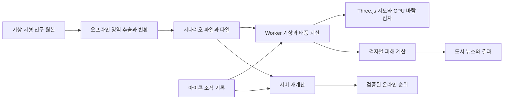

> **2026-10-23 revision:** The current game is a full-screen worldwide, real-time sandbox with one right sidebar and floating map controls. Weather tools are dragged from a bottom palette and have no budget or cost. The world starts without storms; sustained suitable conditions form depressions that grow into multiple typhoons. Map gestures freeze visual animation while simulation time continues. The regional, single-storm, finite-round design below is retained as the original research brief; [IMPLEMENTATION.md](IMPLEMENTATION.md) defines the current implementation.

# 아시아 태풍 시뮬레이션 게임 기획과 기술 조사

실제 아시아 지형과 기상 자료를 바탕으로, 플레이어가 기후 아이콘을 배치해 태풍의 발생·발달·경로를 바꾸고 피해 점수를 높이는 브라우저 게임을 제안합니다. 첫 버전은 북서태평양 한 지역, 태풍 한 개, 고정된 기상 시나리오에 집중합니다. Three.js는 화면을 그리고, 별도 시뮬레이션이 날씨와 피해를 계산하도록 구성합니다.

실제 기상 원리를 반영한 게임용 근사를 목표로 합니다. 플레이어가 조건을 바꾼 뒤의 결과는 새로운 가상 시나리오이며, 실제 예보나 과거 태풍의 정확한 재현으로 표시하지 않습니다.

## nullschool에서 참고할 구조

nullschool은 외부에서 계산된 기상 예보를 시각화합니다. 운영 사이트 설명은 GFS 등 데이터와 D3를 명시하고, 무료 공개 소스로 cambecc/earth를 연결합니다. 공개 소스의 구현은 D3 지리 투영과 SVG 지도 위에 Canvas 바람 입자 및 색상 레이어를 올리는 방식입니다. 공개 코드가 현재 운영 사이트 전체와 동일하다고 단정할 수는 없습니다. [공식 설명](https://earth.nullschool.net/about.html), [공개 저장소](https://github.com/cambecc/earth)

공개 버전의 데이터 흐름은 기상 GRIB2에서 필요한 바람 성분을 추출하고 JSON 격자로 변환한 다음, 브라우저에서 보간·투영하여 입자를 이동시키는 구조입니다. 지구처럼 보이는 화면은 지도 투영으로도 만들 수 있습니다. 따라서 Three.js가 원본의 필수 구성요소는 아니며, 새 게임에서 선택할 렌더러입니다. [구현 설명](https://github.com/cambecc/earth#implementation-notes)

공개 코드는 MIT 라이선스로 제공되며 복제·수정·배포 시 저작권과 라이선스 고지를 유지해야 합니다. 이 조건이 운영 사이트의 모든 이미지·데이터·서비스 이용 권한까지 포함하지는 않습니다. [라이선스 원문](https://github.com/cambecc/earth/blob/master/LICENSE.md)

## 플레이와 화면 구성

한 판의 흐름은 기상 조건 확인 → 발생 조건 조성 → 열대저기압 발달 → 고기압과 저기압으로 주변 바람 조정 → 상륙과 피해 집계 → 뉴스와 순위 확인으로 구성합니다. 해상에서 더 강하게 키울지, 가까운 도시로 일찍 진입할지가 주요 선택입니다.

| 조작 아이콘 | 게임 내 효과 | 제한과 피드백 |
| --- | --- | --- |
| 따뜻한 바다 | 일정 범위의 해수면온도와 발달 잠재력을 높입니다. | 바다에서만 사용하며 유지 비용을 부과합니다. |
| 수증기 | 습도를 높여 발달 조건을 돕습니다. | 단독 사용으로 태풍이 즉시 생성되지는 않습니다. |
| 저기압 | 초기 회전 교란 또는 주변 저기압성 흐름을 만듭니다. | 태풍 생성용 교란과 경로 조정용 기압계를 구분합니다. |
| 고기압 | 주변 순환과 조향류를 바꿉니다. | 강도·반경·지속시간에 따라 비용을 높입니다. |
| 바람 시어 | 높이에 따른 바람 차이를 바꿉니다. | 후속 기능으로 두고, 발달을 방해하는 환경도 보여줍니다. |

아이콘을 놓으면 영향 범위와 비용을 먼저 보여주고, 적용 뒤 기압선·바람·예상 경로가 함께 변하도록 합니다. 효과는 일정 시간에 걸쳐 나타나며 범위·개수·사용 간격을 제한합니다. 태풍을 직접 끌어 이동시키는 조작보다 주변 환경을 바꾸는 조작을 중심에 둡니다.

화면 대부분을 첨부 이미지와 같은 지도에 사용합니다. 어두운 해양 배경, 밝은 해안선, 풍속 색상, 흘러가는 입자, 태풍의 눈과 궤적을 겹칩니다. 왼쪽에는 아이콘, 오른쪽에는 풍속·중심기압·규모·자원, 아래에는 시간 조절과 뉴스 속보를 둡니다. 풍속·기압·수온·인구 레이어를 전환하고 도시 선택 시 기준 연도와 영향 수치를 표시합니다.

## 기상 시뮬레이션의 범위

태풍 발달에는 따뜻한 바다, 습한 대기, 초기 회전과 수렴, 충분한 코리올리 효과, 약한 연직 바람 시어 등이 작용합니다. 해수면온도 약 26.5°C는 대표적인 참고 조건이며, 온도 하나만으로 발생을 결정하면 실제 원리를 잘못 전달하게 됩니다. [NOAA 발생 조건](https://www.aoml.noaa.gov/hrd/tcfaq/A15.html?print=yes)

태풍은 주위 대기의 여러 높이에 걸친 흐름에 의해 이동합니다. 고기압을 장애물이나 밀어내는 자석으로만 구현하기보다, 기압계가 주변 바람을 바꾸고 그 바람이 태풍을 이동시키도록 합니다. 지상에서 보이는 회전 바람과 태풍 중심을 이동시키는 조향류를 구분합니다. [NOAA 이동 원리](https://www.aoml.noaa.gov/hrd/tcfaq/G5.html?print=yes)

제안하는 게임 모델은 다음 상태를 유지합니다.

- 환경 격자: 기압, 지상 바람, 여러 고도의 배경 바람, 수온, 습도, 육해 마스크와 지형입니다.

- 태풍 상태: 위치, 최대풍속, 중심기압, 최대풍속 반경, 강풍 반경, 발달 단계입니다.

- 발생과 발달: 조건이 유지된 시간과 초기 교란을 반영합니다. 따뜻하고 습한 환경에서는 강화되고, 육지·차가운 바다·강한 시어에서는 약화되도록 계수를 조정합니다.

- 이동: 태풍 자체의 회전을 제외한 주변 조향류를 샘플링하고, 게임용 베타 효과 근사를 추가합니다. 자기 바람을 중심 이동에 다시 더하는 오류를 피합니다.

- 바람장: 배경 바람, 플레이어 기압계의 변화, 태풍의 반경별 회전 바람을 합성합니다. 수치와 화면의 풍속이 같은 상태를 사용하도록 합니다.

초기 버전은 전체 대기 방정식을 푸는 대신 매개변수 모델을 사용합니다. 수온·습도·시어의 상호작용과 상륙 후 쇠퇴부터 검증하고, 강수·지형성 효과·폭풍해일·다중 태풍 상호작용은 단계적으로 확장합니다. 기압계의 수직 구조를 생략하는 만큼 경로 정확도에는 한계가 있습니다.

## 데이터 선택과 전처리

| 데이터 | 확인한 특성 | 첫 버전에서의 용도 |
| --- | --- | --- |
| [NOAA GFS](https://www.emc.ncep.noaa.gov/emc/pages/numerical_forecast_systems/gfs.php) | 전구 수치예보, 하루 4회 실행 | 바람·기압·습도의 배경 시나리오를 추출합니다. 원 모델 해상도와 내려받는 격자 해상도를 구분합니다. |
| [NOAA OISST v2.1](https://www.ncei.noaa.gov/products/optimum-interpolation-sst) | 0.25° 일별 해수면온도, NetCDF | 태풍 발달의 배경 수온에 사용합니다. 해양 내부 열량을 직접 나타내는 자료는 아닙니다. |
| [IBTrACS v4r01](https://www.ncei.noaa.gov/products/international-best-track-archive) | 여러 기관의 과거 태풍 기록, CSV·NetCDF·Shapefile | 경로 재생 및 모델 보정에 사용합니다. 기관별 풍속 평균시간과 결측값을 통일합니다. |
| [Natural Earth](https://www.naturalearthdata.com/downloads/) | 여러 축척의 해안선·국경·도시점 | 지도와 초기 도시 표시에 사용합니다. 1:10m은 1천만분의 1 축척이며 10m 공간해상도가 아닙니다. |
| [GEBCO 2026](https://www.gebco.net/data-products/gridded-bathymetry-data) | 육지·해저를 포함한 15각초 격자, NetCDF·GeoTIFF | 지형 배경과 해안 구분에 사용합니다. 도로 단위 침수 계산에는 별도 고해상도 지형이 필요합니다. |
| [GHS-POP R2023A](https://registry.opendata.aws/ghs-pop/) | 100m·1km 인구 격자, 5년 간격 | 피해에 노출되는 인구를 셀별로 계산합니다. 2025·2030 값은 해당 제품의 전망치입니다. |
| [GHS-UCDB R2024A](https://human-settlement.emergency.copernicus.eu/ghs_ucdb_2024.php) | 도시 중심 지역의 경계·속성, GeoPackage 등 | 도시별 집계 단위를 통일합니다. 행정구역 인구 또는 광역권 인구와 혼용하지 않습니다. |

Natural Earth는 퍼블릭 도메인입니다. GEBCO는 상업적 활용을 허용하며 출처 표기를 요구합니다. GHS-POP의 JRC 배포 등록에는 CC BY 4.0이 명시됩니다. NOAA NODD는 자유로운 활용과 출처 표기를 안내하며 변형 결과를 원본 NOAA 자료로 표시하지 않도록 합니다. 제품별 고지와 버전은 시나리오 메타데이터에 함께 보관합니다. [Natural Earth 약관](https://www.naturalearthdata.com/about/terms-of-use/), [GEBCO 약관](https://www.gebco.net/data-products/gridded-bathymetry/terms-of-use), [GHS-POP 조건](https://registry.opendata.aws/ghs-pop/), [NOAA NODD 조건](https://registry.opendata.aws/noaa-gfs-bdp-pds/)

원본 GRIB2·NetCDF·GeoTIFF는 오프라인 또는 서버에서 아시아 영역으로 잘라 좌표·단위·시각을 맞춘 뒤 작은 격자와 타일로 배포합니다. 인구는 셀당 인원인지 면적당 밀도인지 확인하고, 재투영할 때 총인구가 보존되도록 집계합니다. 결측값을 0으로 바꾸지 않습니다.

첫 시나리오는 확보 가능한 날짜의 기상 자료를 고정합니다. 과거 태풍 기록만으로 당시의 전체 기상장이 복원되지는 않으므로 배경 자료가 부족하면 역사적 경로를 참고한 가상 시나리오로 명명합니다. 초기 태풍을 별도로 넣는 경우 원래 배경장에 있던 태풍을 중복 합성하지 않습니다.

## Three.js 구현 제안

TypeScript와 Three.js의 WebGL2 렌더러를 사용하고, 기상·태풍·피해 계산은 Web Worker의 고정 시간 간격 루프로 분리합니다. 화면 입자는 시각 효과이며 점수 계산의 근거가 되지 않습니다. [WebGLRenderer 공식 문서](https://threejs.org/docs/pages/WebGLRenderer.html)

바람 벡터 격자와 입자 위치를 텍스처로 관리하고, 두 렌더 타깃을 번갈아 사용하는 방식으로 입자를 갱신합니다. Three.js의 GPUComputationRenderer가 이 구조를 제공합니다. 잔상은 별도 화면 버퍼에 누적하되 지도 이동 시 초기화하거나 다시 투영하여 해안선과 어긋나지 않도록 합니다. [GPUComputationRenderer 문서](https://threejs.org/docs/pages/GPUComputationRenderer.html)

처음에는 아시아 평면 지도에서 조작과 성능을 검증하고, 위경도를 공통 좌표로 유지하여 회전 가능한 지구본을 추가합니다. 위도에 따른 거리 차이와 투영 왜곡을 처리해야 하며, 평면 화면을 쓴다고 물리 계산의 좌표 문제가 사라지지는 않습니다.

초기 검증 목표는 입자 약 6만 개에서 데스크톱 60fps, 저사양에서 입자·화면 해상도를 줄여 30fps입니다. 이는 측정 결과가 아닌 목표입니다. Float32 위치 정밀도, 부동소수점 렌더 타깃과 필터 지원을 실제 기기에서 확인하고 실패 시 CPU·Canvas 기반 저품질 경로를 준비합니다. HalfFloat로 바꾸는 것만으로 모든 호환성 문제가 해결되지는 않습니다.

구현 모듈은 데이터 로딩, 지리 좌표, 환경장, 태풍 모델, 피해 모델, 렌더러, 입력, 뉴스, 재생 기록으로 나눕니다. 지도 드래그와 아이콘 드래그를 구분하고, 줌·회전·배속 변경으로 시뮬레이션 결과가 달라지지 않도록 합니다.

## 피해 뉴스와 랭킹

피해는 태풍 중심선과 도시점의 충돌 대신, 강풍 범위와 노출 격자의 겹침으로 계산합니다. 재해 강도·노출 자산·취약성 곡선을 조합하는 방식은 CLIMADA의 기본 구조를 참고할 수 있습니다. [CLIMADA 영향 계산](https://climada-python.readthedocs.io/en/v6.1.0/user-guide/0_10min_climada.html)

첫 버전의 피해율은 풍속에 따라 0에서 1로 증가하는 게임용 함수로 정합니다. 셀별 최대 피해율을 보관하고 이전 최대값보다 증가한 부분만 점수에 더하면, 같은 장소에서 태풍이 맴돌거나 화면 갱신 횟수가 늘어도 동일 피해가 반복 가산되지 않습니다. 각 셀은 도시 집계에서 한 번만 포함하며 도시 밖 지역의 피해도 별도로 합산합니다.

인구 × 게임용 피해율로 계산한 값은 피해 점수이며 실제 재산 손실액이나 실제 피해 인원이 아닙니다. 강풍에 노출된 인구는 별도 지표로 표시합니다. 금액을 도입하려면 건물·시설의 자산 가치, 가격 기준 연도와 지역별 취약성을 추가해야 합니다. 미국용 경험 피해 곡선의 계수를 아시아 전체에 그대로 적용하지 않습니다. [지역별 태풍 피해 함수 구현](https://climada-python.readthedocs.io/en/stable/_modules/climada/entity/impact_funcs/trop_cyclone.html)

뉴스는 상륙, 도시 피해 단계 상승, 최대 피해 갱신, 태풍 소멸을 사건으로 받아 생성합니다. 같은 사건의 반복 알림을 막고, 도시·피해 유형·강도에 맞는 사전 제작 그림이나 짧은 영상을 선택합니다. 기사에 표시하는 수치는 점수 계산 결과에서 가져오며 화면에 ‘게임 내 가상 속보’를 표시합니다. 첫 버전은 이미지와 문장 템플릿으로 구성하고 영상 연출을 확장합니다.

랭킹은 동일 시나리오·시드·시뮬레이션 버전·자원 예산끼리 비교합니다. 첫 버전에는 로컬 순위를 넣고, 온라인 순위는 클라이언트가 보낸 점수를 바로 믿지 않고 초기 상태와 시간별 조작 기록을 서버에서 재계산하여 등록합니다. 모바일에서 입자 수를 줄여도 점수는 같아야 합니다.

## 개발 순서와 검증 기준

| 단계 | 구현 범위 | 다음 단계로 넘어갈 기준 |
| --- | --- | --- |
| 화면 실험 | 아시아 해안선, 고정 바람장, 입자, 줌과 드래그 | 입력 좌표와 표시 위치가 일치하고 목표 기기에서 프레임 시간을 측정합니다. |
| 조작 실험 | 태풍 1개, 고기압·저기압, 비용과 시간 진행 | 같은 시드와 조작이 같은 결과를 만들고, 기압계 변경에 바람과 진로가 함께 반응합니다. |
| 발생과 발달 | 수온·습도 아이콘, 시어 영향, 상륙 후 약화 | 각 조건을 하나씩 바꿨을 때 설계한 강화·약화 관계가 나타납니다. |
| 한 판 완성 | 인구 격자, 도시 집계, 뉴스 그림, 로컬 순위 | 태풍 발생부터 소멸·결과까지 한 판이 완결되고 피해 중복 계산이 없습니다. |
| 확장 | 지구본, 온라인 순위, 강수·해일, 영상 | 서버 검증 및 추가 재해 모델의 자료와 정확도를 각각 검증합니다. |

초기 지리 범위는 필리핀·대만·중국 동부·한반도·일본을 포함하는 북서태평양으로 잡습니다. 도시 후보는 마닐라, 타이베이, 가오슝, 홍콩, 상하이, 부산, 서울, 오사카, 도쿄입니다. 도시 중심을 맞혀야만 점수가 발생하는 규칙은 두지 않습니다.

검증은 네 범주로 진행합니다. 첫째, 북반구 고저기압의 회전 방향과 조향 반응을 단순한 합성 사례에서 확인합니다. 둘째, 과거 사례의 이동속도·발달·상륙 쇠퇴를 비교하되 보정에 쓰지 않은 사례도 검증합니다. 셋째, 피해율 범위·인구 총량·도시 경계 중복·단위 변환을 검사합니다. 넷째, 화면 배속과 프레임률 변화, 컨텍스트 복구, 반복 시나리오 로딩을 시험합니다.

기상 계수, 지역별 취약성, 모바일 입자 한도는 프로토타입에서 결정할 항목입니다. 현재 결과는 구현 전 조사와 설계안이며, 예보 정확도나 실행 성능을 측정한 결과는 아닙니다.

## 조사 참여와 기준

조사일은 2026년 10월 22일입니다. Paseo의 Claude (three) 계정에서 Opus 5.5는 기상 모델과 게임 설계, Sonnet 5.5는 nullschool 구조와 Three.js, Haiku 5.5는 데이터 후보를 조사했습니다. ‘클로드3’은 이 계정으로 해석했으며 과거 Claude 3 세대 모델을 실행한 것은 아닙니다.

통합 과정에서 공식 자료를 다시 확인하여 GEBCO를 2026 자료로 갱신하고, OISST의 NetCDF 제공과 GHS-UCDB 도시 경계를 확인했습니다. GFS의 이용 조건은 확인한 NOAA 배포 안내에 맞춰 기술했습니다. 지균풍 하나로 모든 태풍 이동을 설명하거나 특정 기온에서 발생이 절대 불가능하다고 단정하는 제안은 채택하지 않았습니다.

