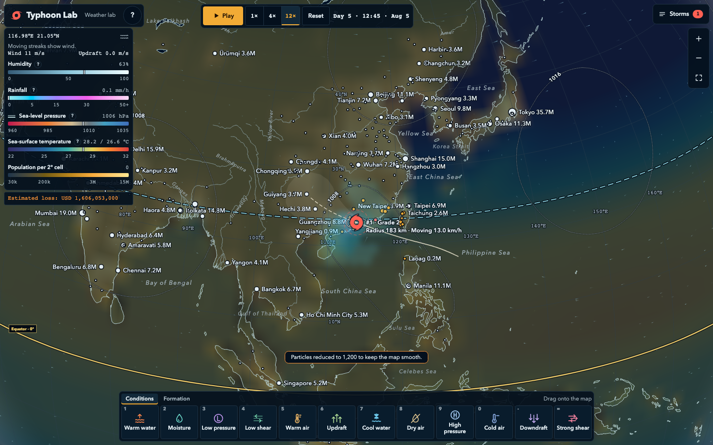
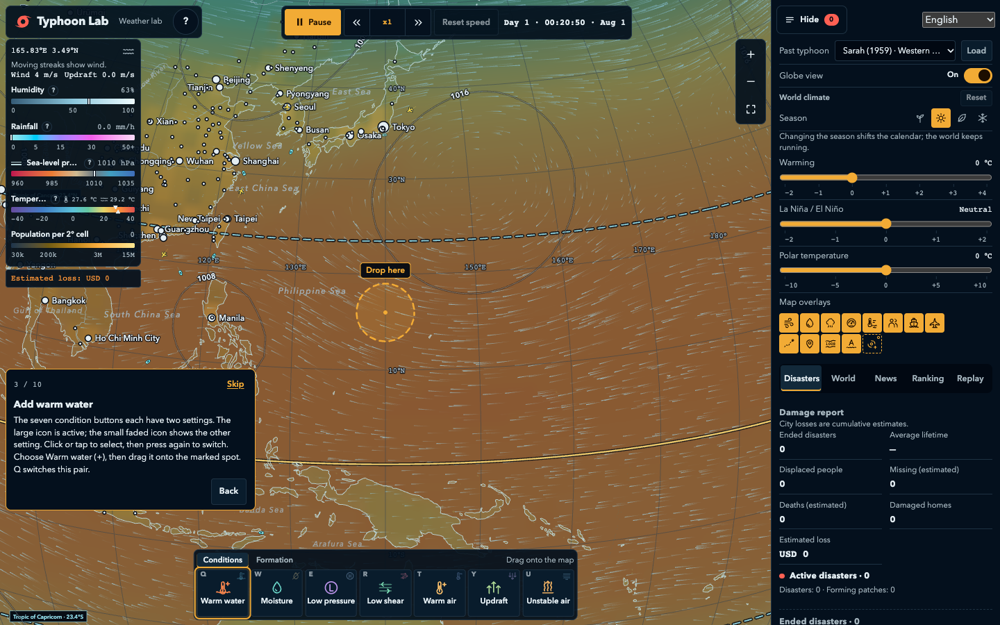
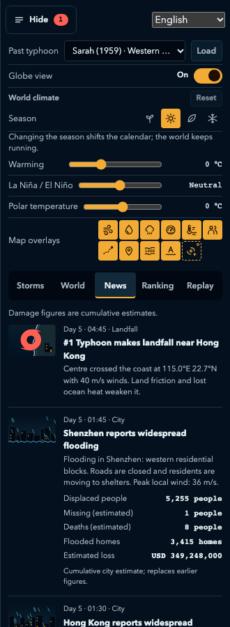
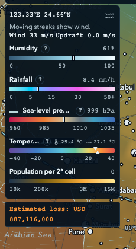
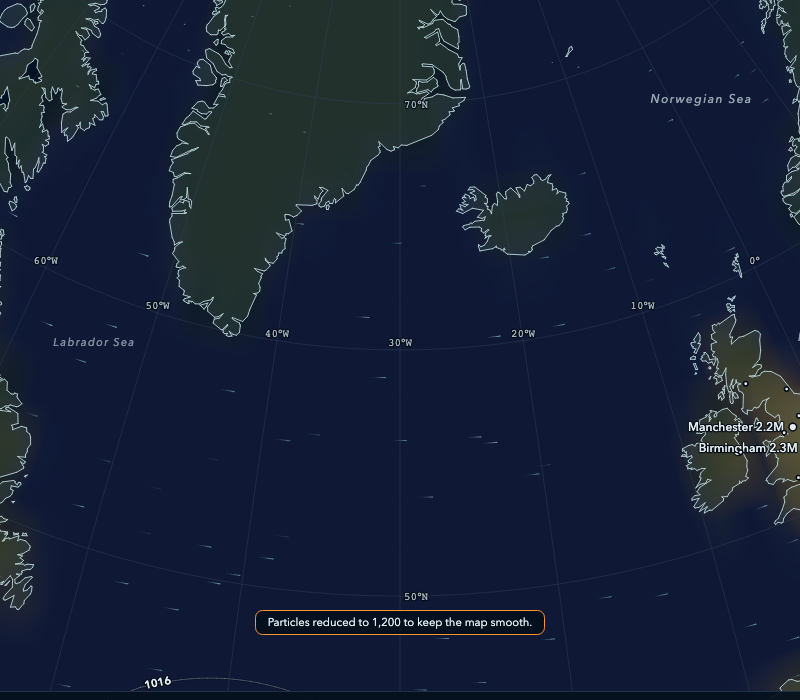
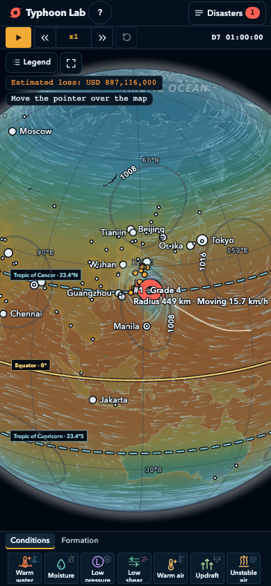

<p align="center">
  
</p>

<p align="center">
  <b>English</b> · <a href="#korean">한국어</a>
</p>

<p align="center">
  
  
  
  
  <a href="https://typhoon.typostudio.dev"></a>
</p>

# Typhoon Lab

A browser **weather sandbox** where you build **typhoons** by dragging warm water, moist air, and low pressure onto a world map, then weaken them before they hit a city. It runs on a **deterministic global simulation**, so every storm can be replayed exactly. **No install needed:** [**play it here**](https://typhoon.typostudio.dev).

<p align="center">
  
</p>

## Features

- 🌀 **Build a storm from scratch** — drag **Warm water**, **Moisture**, and **Low pressure** onto the same patch of tropical ocean away from the equator. If the conditions hold, a depression forms and can grow into a typhoon.
- 🧰 **Twelve weather tools** — to build: Warm water, Moisture, Low pressure, Low shear, Warm air, Updraft. To weaken: Cool water, Dry air, High pressure, Cold air, Downdraft, Strong shear.
- 🛡️ **Protect the cities** — weaken storms before they make landfall. Turn on natural formation and waves of new storms arrive on their own, like a defense mode.
- 🎓 **Interactive tutorial** — on your first visit, a step-by-step card walks you through building a typhoon and then defending against one.
- 🌍 **Flat map and 3D globe** — wind streaks coloured by humidity, blurred rain clouds tiled in hexagons, isobars, a sea-temperature tint, and population. A legend shows live values under the pointer.
- 📚 **40 real past storms** — replay Katrina, Haiyan, Mangkhut, and more from official best-track records. Replays export and import as JSON.
- 🗞️ **City news feed** — illustrated bulletins report displaced people, flooded homes, and estimated losses as damage grows.
- 🏆 **Rankings and leaderboard** — rank storms by loss, grade, or survival time, and compare scores with other players online.
- 🌐 **Localized** — English, Korean, Japanese, Simplified Chinese, and Traditional Chinese.
- 📱 **Desktop and phone** — the same game with touch controls on a narrow screen.

## Gameplay

Pick a tool from the bottom palette and drag it onto the map. Each tool has a radius and a lifetime, shown while you drag. Overlapping **warm sea + moist air + a low** away from the equator is the recipe for a depression. Keep the conditions alive long enough and it deepens into a storm. Then switch sides: place **Cool water**, **Dry air**, **Cold air**, **Downdraft**, or **Strong shear** on and ahead of its track to tear it apart. **High pressure** steers it instead.

Turn on **Natural typhoon formation** and the world starts storms by itself, so you can spend the whole game on defense. Open `?seed=<number>` to start from a fixed world. Check the **Tutorial** button in the help panel at any time.

<table align="center">
  <tr>
    <td align="center" valign="top"></td>
    <td align="center" valign="top"></td>
  </tr>
  <tr>
    <td align="center"><sub>City news feed</sub></td>
    <td align="center"><sub>Legend with live values</sub></td>
  </tr>
</table>

## Simulation

- **Global 2° grid, 15-minute steps.** Everything is seeded and deterministic: the same seed and the same actions always produce the same world.
- **Real seasons.** The calendar starts on today's date. Three sliders (**warming**, **La Niña / El Niño**, **polar temperature**) shift the climate of the whole world.
- **More than wind.** Rainfall, snow, and blizzards (with snow-load damage), land friction, thunderstorms, storm mergers, and remnant lows after a storm dissipates.
- **Damage that matters.** Cumulative, fictional loss estimates are calibrated on the Typhoon Maemi (2003) records. Damage recovers over time.
- **Replayable.** Export any run as JSON and import it later to get the same storms back.

<p align="center">
  
</p>

## Past storm library

Forty real storms are bundled and can be loaded into the same world as your own:

- **14 western Pacific typhoons** from the JMA RSMC Tokyo best track, from Sarah (1959) to Hinnamnor (2022), including Tip, Haiyan, and Mangkhut. Their sea temperature, air, humidity, and wind come from NCEP/NCAR Reanalysis 1 and ERSST v5.
- **26 storms worldwide** from NOAA HURDAT2 and IBTrACS, including Katrina, Sandy, Harvey, Irma, Maria, Dorian, Ian, Patricia, Otis, Nargis, Amphan, Idai, Freddy, Tracy, Winston, Pam, Yasi, and Catarina.

A loaded storm follows its recorded path. The conditions you place change its strength, not its track.

## Data sources

Coastlines, lakes, rivers, and city locations come from [Natural Earth](https://www.naturalearthdata.com/) (public domain). Past storm tracks come from the [JMA RSMC Tokyo best track](https://www.jma.go.jp/jma/jma-eng/jma-center/rsmc-hp-pub-eg/trackarchives.html) (JMA Public Data License 1.0, attribution required), [NOAA NHC HURDAT2](https://www.nhc.noaa.gov/data/hurdat/), and [NOAA NCEI IBTrACS](https://www.ncei.noaa.gov/products/international-best-track-archive) (both public domain). Historical environments use NCEP/NCAR Reanalysis 1 and ERSST v5, provided by the [NOAA PSL](https://psl.noaa.gov). Weather outside the replays, rural population, and all damage figures are fictional. This is not a real forecast. Full details are in [DATA_SOURCES.md](DATA_SOURCES.md).

JMA best-track data was edited and processed by TypoStudio; the Japan Meteorological Agency did not create the edited data. NCEP Reanalysis data provided by the NOAA PSL, Boulder, Colorado, USA, from their website at https://psl.noaa.gov. IBTrACS: Knapp, K. R. et al., 2010, doi:10.1175/2009BAMS2755.1.

## License

Except where noted, the source code, text, graphics and the data this project created are licensed under [**CC BY-NC-SA 4.0**](https://creativecommons.org/licenses/by-nc-sa/4.0/): free to use and modify, **no commercial use**, and modified versions must be shared under the same license with credit.

- **Source-available, not OSI open source.** The non-commercial clause means this is not an "open source" license by the OSI definition. Commercial licenses are available on request: typ0s2d10@gmail.com.
- **Third-party libraries keep their own licenses** (MIT, Apache-2.0, and others). See [THIRD_PARTY_NOTICES.md](THIRD_PARTY_NOTICES.md). The full texts are served at [/third-party-licenses.txt](https://typhoon.typostudio.dev/third-party-licenses.txt) and generated by `npm run prepare:licenses`.
- **Third-party data keeps its own terms** (Natural Earth and NOAA are public domain; JMA data is under the JMA Public Data License 1.0). See [DATA_SOURCES.md](DATA_SOURCES.md). Nothing in the project license restricts what those sources allow.
- **How to give credit:** `Typhoon Lab by TypoStudio, CC BY-NC-SA 4.0, https://typhoon.typostudio.dev`

The full legal code is in [LICENSE](LICENSE); the scope and exclusions are in [COPYRIGHT.md](COPYRIGHT.md).

## Build from source

Requires Node.js 22.12+. To enable the leaderboard, copy `.env.example` to `.env.local` and fill in your Firebase web config; without it the game runs with the leaderboard disabled.

```bash
npm install
npm run dev          # dev server at http://localhost:5186
npm run build        # tsc + vite build → dist/
npm test             # unit tests (vitest)
npm run test:e2e     # browser tests (Playwright)
firebase deploy --only hosting
```

The past storm data is generated by scripts. Run them in this order after changing the sources.

```bash
node scripts/prepare-typhoons.mjs        # 14 JMA typhoons
node scripts/prepare-world-storms.mjs    # 26 worldwide storms
node scripts/prepare-environment.mjs     # reanalysis environments
```

## Project structure

```
src/simulation/    Deterministic engine: genesis, steering, intensity, damage, news, historic replay
src/render/        Flat map, 3D globe, wind particles, rain hexagons, isobars
src/ui/            Shell, palette, input, legend, rankings, calendar, tutorial
src/data/          Geography, cities, places, and generated storm and environment data
src/locales/       Korean, Japanese, Simplified and Traditional Chinese strings
src/net/           Firebase leaderboard
scripts/           Data preparation scripts
tests/             Vitest unit tests and browser tests
assets/            Screenshots
docs/              Developer notes
```

## Notes

- Developer notes: [docs/DEVELOPMENT.md](docs/DEVELOPMENT.md). Design contract: [IMPLEMENTATION.md](IMPLEMENTATION.md). Validation: [VALIDATION.md](VALIDATION.md).
- Leaderboard entries use an anonymous ID and a nickname you choose, which is public. See the [privacy policy](https://typhoon.typostudio.dev/privacy.html).
- The impact figures measure fictional wind exposure. They are game scores, not casualty or financial-loss estimates.

<p align="center">
  
</p>

## Support

If you like this game, you can support it with a cup of coffee ☕

<a href="https://www.buymeacoffee.com/typ0s2d10" target="_blank"></a>

---

<a id="korean"></a>

<p align="center">
  <a href="#typhoon-lab">English</a> · <b>한국어</b>
</p>

# Typhoon Lab

세계 지도 위에 따뜻한 바다, 습한 공기, 저기압을 끌어다 놓아 **태풍**을 만들고, 도시를 덮치기 전에 약화시키는 브라우저 **날씨 샌드박스**입니다. **결정론적 전 지구 시뮬레이션**으로 움직이므로 모든 태풍을 그대로 다시 재생할 수 있습니다. **설치 없이** [**바로 플레이**](https://typhoon.typostudio.dev)할 수 있습니다.

<p align="center">
  
</p>

## 기능

- 🌀 **태풍을 처음부터 만들기** — **따뜻한 바다**, **수분 공급**, **저기압**을 적도에서 떨어진 같은 열대 바다 위에 끌어다 놓습니다. 조건이 유지되면 열대저압부가 생기고 태풍으로 자랄 수 있습니다.
- 🧰 **날씨 도구 12종** — 만들기: 따뜻한 바다, 수분 공급, 저기압, 약한 시어, 따뜻한 기온, 상승 기류. 약화: 차가운 바다, 건조한 공기, 고기압, 차가운 공기, 하강 기류, 강한 시어.
- 🛡️ **도시 지키기** — 상륙하기 전에 태풍을 약화시키세요. 자연 발생을 켜면 새 태풍이 파도처럼 계속 찾아오므로 방어 모드처럼 즐길 수 있습니다.
- 🎓 **대화형 튜토리얼** — 처음 방문하면 안내 카드가 태풍을 만드는 법과 막는 법을 단계별로 알려 줍니다.
- 🌍 **평면 지도와 3D 지구본** — 습도에 따라 색이 달라지는 바람 줄기, 육각형으로 이어 붙인 흐릿한 비구름, 등압선, 해수면 온도 색조, 인구. 범례는 포인터 아래의 실시간 값을 보여 줍니다.
- 📚 **실제 과거 태풍 40개** — 공식 최적 경로 기록으로 Katrina, Haiyan, Mangkhut 등을 다시 재생합니다. 재생 기록은 JSON으로 내보내고 가져올 수 있습니다.
- 🗞️ **도시 뉴스 피드** — 피해가 커지면 이재민, 침수 가옥, 추정 손실을 삽화와 함께 속보로 전합니다.
- 🏆 **랭킹과 순위표** — 손실, 등급, 생존 시간으로 태풍 순위를 매기고 온라인에서 다른 플레이어와 점수를 비교합니다.
- 🌐 **다국어** — 영어, 한국어, 일본어, 중국어 간체·번체.
- 📱 **데스크톱과 휴대폰** — 좁은 화면에서는 터치 조작으로 같은 게임을 즐깁니다.

## 게임 방법

아래쪽 팔레트에서 도구를 골라 지도에 끌어다 놓습니다. 도구마다 반경과 지속 시간이 있으며 드래그하는 동안 표시됩니다. 적도에서 떨어진 곳에 **따뜻한 바다 + 습한 공기 + 저기압**이 겹치면 열대저압부가 생깁니다. 조건을 충분히 오래 유지하면 폭풍으로 발달합니다. 그다음에는 반대편이 되어, 진로 위와 앞쪽에 **차가운 바다**, **건조한 공기**, **차가운 공기**, **하강 기류**, **강한 시어**를 놓아 태풍을 무너뜨리세요. **고기압**은 약화가 아니라 진로를 바꿉니다.

**태풍 자연 발생**을 켜면 월드가 스스로 태풍을 만들어 내므로 처음부터 끝까지 방어에 집중할 수 있습니다. `?seed=<숫자>`로 열면 고정된 월드에서 시작합니다. 도움말 패널의 **튜토리얼** 버튼으로 언제든 다시 볼 수 있습니다.

<table align="center">
  <tr>
    <td align="center" valign="top"></td>
    <td align="center" valign="top"></td>
  </tr>
  <tr>
    <td align="center"><sub>도시 뉴스 피드</sub></td>
    <td align="center"><sub>실시간 값을 보여 주는 범례</sub></td>
  </tr>
</table>

## 시뮬레이션

- **2° 전 지구 격자, 15분 단위 스텝.** 모든 것이 시드 기반이며 결정론적입니다. 같은 시드와 같은 행동은 항상 같은 월드를 만듭니다.
- **실제 계절.** 달력은 오늘 날짜에서 시작합니다. 슬라이더 세 개(**온난화**, **라니냐/엘니뇨**, **극지 기온**)로 월드 전체의 기후를 바꿀 수 있습니다.
- **바람만이 아닙니다.** 강수, 눈, 눈보라(적설 하중 피해 포함), 지표 마찰, 뇌우, 태풍 병합, 소멸 뒤 남는 저기압.
- **의미 있는 피해.** 누적되는 가상의 손실 추정치는 태풍 매미(2003) 기록으로 보정했습니다. 피해는 시간이 지나면 회복됩니다.
- **재생 가능.** 어떤 플레이든 JSON으로 내보냈다가 나중에 가져오면 같은 태풍이 그대로 다시 나옵니다.

<p align="center">
  
</p>

## 과거 태풍 라이브러리

실제 태풍 40개가 들어 있으며 내가 만든 태풍과 같은 월드에 불러올 수 있습니다.

- **서태평양 태풍 14개** — JMA RSMC Tokyo 최적 경로 기준, Sarah(1959)부터 Hinnamnor(2022)까지이며 Tip, Haiyan, Mangkhut도 포함됩니다. 해수면 온도, 기온, 습도, 바람은 NCEP/NCAR Reanalysis 1과 ERSST v5를 따릅니다.
- **전 세계 태풍 26개** — NOAA HURDAT2와 IBTrACS 기준이며 Katrina, Sandy, Harvey, Irma, Maria, Dorian, Ian, Patricia, Otis, Nargis, Amphan, Idai, Freddy, Tracy, Winston, Pam, Yasi, Catarina 등이 있습니다.

불러온 태풍은 기록된 경로를 따릅니다. 내가 놓은 조건은 강도를 바꿀 뿐 경로는 바꾸지 않습니다.

## 데이터 출처

해안선, 호수, 강, 도시 위치는 [Natural Earth](https://www.naturalearthdata.com/)(퍼블릭 도메인)에서 가져왔습니다. 과거 태풍 경로는 [JMA RSMC Tokyo 최적 경로](https://www.jma.go.jp/jma/jma-eng/jma-center/rsmc-hp-pub-eg/trackarchives.html)(JMA 공공 데이터 라이선스 1.0, 출처 표기 필수), [NOAA NHC HURDAT2](https://www.nhc.noaa.gov/data/hurdat/), [NOAA NCEI IBTrACS](https://www.ncei.noaa.gov/products/international-best-track-archive)(둘 다 퍼블릭 도메인)입니다. 과거 환경 자료는 [NOAA PSL](https://psl.noaa.gov)이 제공하는 NCEP/NCAR Reanalysis 1과 ERSST v5입니다. 과거 태풍 재생 이외의 날씨, 농촌 인구, 모든 피해 수치는 가상입니다. 실제 예보가 아닙니다. 자세한 내용은 [DATA_SOURCES.md](DATA_SOURCES.md)를 참고하세요.

JMA 베스트트랙 자료는 TypoStudio가 편집·가공했으며, 편집된 자료는 일본 기상청이 작성한 것이 아닙니다. NCEP 재분석 자료는 미국 콜로라도주 볼더의 NOAA PSL이 웹사이트 https://psl.noaa.gov 를 통해 제공합니다. IBTrACS: Knapp, K. R. 외, 2010, doi:10.1175/2009BAMS2755.1.

## 라이선스

별도 표기가 없는 한 소스 코드, 글, 그래픽, 이 프로젝트가 직접 만든 데이터는 [**CC BY-NC-SA 4.0**](https://creativecommons.org/licenses/by-nc-sa/4.0/deed.ko)으로 배포됩니다. 자유롭게 사용하고 수정할 수 있지만 **상업적 이용은 금지**되며, 수정본은 출처를 밝히고 같은 라이선스로 공유해야 합니다.

- **소스 공개(source-available)이며 OSI 오픈소스가 아닙니다.** 비영리 조항 때문에 OSI 정의상 "오픈소스" 라이선스가 아닙니다. 상업적 이용 라이선스는 요청 시 제공합니다: typ0s2d10@gmail.com.
- **서드파티 라이브러리는 각자의 라이선스를 따릅니다** (MIT, Apache-2.0 등). [THIRD_PARTY_NOTICES.md](THIRD_PARTY_NOTICES.md)를 참고하세요. 전문은 [/third-party-licenses.txt](https://typhoon.typostudio.dev/third-party-licenses.txt)에서 제공하며 `npm run prepare:licenses`로 생성합니다.
- **서드파티 데이터는 각자의 이용 조건을 따릅니다** (Natural Earth와 NOAA는 퍼블릭 도메인, JMA 자료는 JMA 공공 데이터 라이선스 1.0). [DATA_SOURCES.md](DATA_SOURCES.md)를 참고하세요. 이 프로젝트의 라이선스는 해당 출처가 허용하는 범위를 제한하지 않습니다.
- **출처 표기 방법:** `Typhoon Lab by TypoStudio, CC BY-NC-SA 4.0, https://typhoon.typostudio.dev`

라이선스 전문은 [LICENSE](LICENSE)에, 적용 범위와 예외는 [COPYRIGHT.md](COPYRIGHT.md)에 있습니다.

## 소스에서 빌드

Node.js 22.12 이상이 필요합니다. 순위표를 켜려면 `.env.example`을 `.env.local`로 복사해 Firebase 웹 설정을 채우십시오. 설정이 없으면 순위표가 꺼진 채로 게임이 실행됩니다.

```bash
npm install
npm run dev          # 개발 서버 http://localhost:5186
npm run build        # tsc + vite build → dist/
npm test             # 단위 테스트 (vitest)
npm run test:e2e     # 브라우저 테스트 (Playwright)
firebase deploy --only hosting
```

과거 태풍 데이터는 스크립트로 생성합니다. 원본을 바꾼 뒤에는 아래 순서대로 실행하세요.

```bash
node scripts/prepare-typhoons.mjs        # JMA 태풍 14개
node scripts/prepare-world-storms.mjs    # 전 세계 태풍 26개
node scripts/prepare-environment.mjs     # 재분석 환경 자료
```

## 프로젝트 구조

```
src/simulation/    결정론적 엔진: 발생, 조향, 강도, 피해, 뉴스, 과거 태풍 재생
src/render/        평면 지도, 3D 지구본, 바람 입자, 비구름 육각형, 등압선
src/ui/            셸, 팔레트, 입력, 범례, 랭킹, 달력, 튜토리얼
src/data/          지리, 도시, 지명, 생성된 태풍·환경 데이터
src/locales/       한국어, 일본어, 중국어 간체·번체 문자열
src/net/           Firebase 순위표
scripts/           데이터 준비 스크립트
tests/             Vitest 단위 테스트와 브라우저 테스트
assets/            스크린샷
docs/              개발자 노트
```

## 참고

- 개발자 노트: [docs/DEVELOPMENT.md](docs/DEVELOPMENT.md). 설계 기준: [IMPLEMENTATION.md](IMPLEMENTATION.md). 검증: [VALIDATION.md](VALIDATION.md).
- 순위표에는 익명 ID와 직접 정한 닉네임이 올라가며, 닉네임은 공개됩니다. [개인정보처리방침](https://typhoon.typostudio.dev/privacy.html?lang=ko)을 참고하세요.
- 피해 수치는 가상의 바람 노출량을 재는 값입니다. 게임 점수일 뿐 사상자나 금전 손실 추정치가 아닙니다.

<p align="center">
  
</p>

## 후원

이 게임이 마음에 드신다면 커피 한 잔으로 응원해 주세요 ☕

<a href="https://www.buymeacoffee.com/typ0s2d10" target="_blank"></a>
